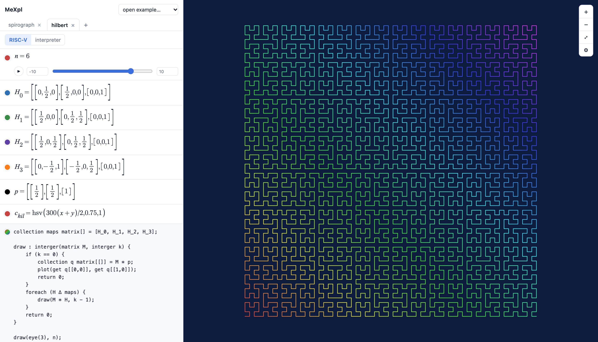
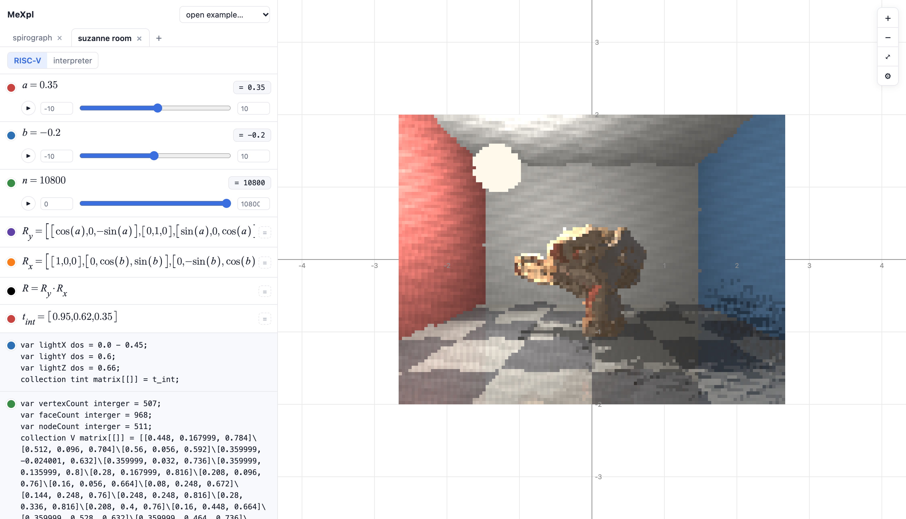

# MeXpl

**[Browser Demo](https://justinjordan1.github.io/Jostins-programming-language/)**

A Hilbert curve in the editor, defined mathematically

blender monke but raytraced

formerly C10H15N. cringe but its part of the culture thats what happens when youre 16

Created in Spring 2023 by Jostin (functionally extended in 2026)
_____
MeXpl is a language whos primary purpose (at least at the present moment) is to create "math explainers", in other
words, animations that visually display mathematical concepts. One might say "why make a whole language for this", especially through java, and fair enough. 
it also compiles to riscV cause yeah
____

Files end in `.mexpl` 
## Running

| | | |
|---|---|---|
| Interpret | `java -cp out src.C10H15N f.mexpl` | run with the Java interpreter |
| Compile | `riscv/run.sh f.mexpl` | compile to RISC-V, run in QEMU |
| Editor | `java -cp out src.Editor.EditorServer` | open localhost:8123 |

## Types

| | | |
|---|---|---|
| Whole number | `interger` | ℤ, `3` |
| Decimal | `dos` | ℝ, `2.5` |
| Boolean | `george` | `true`, `false` |
| Text | `string` | `"hi"` |
| Matrix | `matrix` | `[[1, 2]\[3, 4]]` |
| Object | `object` | `Point(1, 2)` |
| Function | `function` | `: dos(dos x) { … }` |

## Statements

| | | |
|---|---|---|
| Declare | `var x dos = 1.5;` | needs a starting value |
| Declare several | `var a, b interger = 0;` | |
| Assign | `x = x + 1;` | |
| Comment | `ç … ø` | |
| Print | `print(a, " ", b, "\n");` | no spaces or newline added |
| Return | `return e;` | |

## Functions

| | | |
|---|---|---|
| Define | `f : dos(dos a, dos b) { return a + b; }` | name : return type(params) |
| Call | `f(1.0, 2.0)` | |
| Lambda | `: dos(dos x) { return x * x; }` | function with no name |
| Store one | `var g function = : dos(dos x) { … };` | |
| Closure | a lambda keeps the variables around it | |
| Call a returned function | `makeAdder(5)(10)` | |
| Pipe | `x \|> f \|> g` | g(f(x)) |
| Compose | `compose(f, g)` | f ∘ g |

## Classes

| | | |
|---|---|---|
| Define | `class P { var x dos = 0.0; … }` | fields and methods |
| Constructor | `init : interger(dos a) { this.x = a; return 0; }` | runs on `P(…)` |
| Method | `len : dos() { return x * x; }` | fields by name or `this.x` |
| Make | `var p object = P(3.0);` | |
| Use | `p.len()`  `p.x`  `p.x = 1.0;` | |

## Control flow

| | | |
|---|---|---|
| If | `if (c) { } elseif (c) { } else { }` | |
| Count up | `for (var i interger = 0; i < n)¬+ { }` | i += 1 |
| Count down | `for (var i interger = n; i > 0)¬- { }` | i −= 1 |
| While | `while (c) { }` | |
| Forever | `indefinitlypreform { }` | until `break;` |
| Roughly while | `whilethisisbasicallytrue (r) 10% { }` | while \|r − 1\| ≤ 10% |
| For each | `foreach (x ∆ xs) { }` | lists, or matrix cells row by row |
| Break | `break;` | leave the loop |

## Operators

| | | |
|---|---|---|
| Add, subtract | `+ -` | numbers, A ± B |
| Multiply | `*` | numbers, A·B, kA |
| Divide | `/` | ℤ / ℤ drops the remainder |
| Power | `î` | 2 î 10 = 1024 |
| Inverse | `í` | 1/x, A⁻¹ |
| Dot product | `˚` | u · v, as 1×1 |
| Remainder | `%%` | 7 %% 3 = 1 |
| Equal, not equal | `== =/=` | = ≠ |
| Compare | `< > <= >=` | < > ≤ ≥ |
| And, or, not | `& \| !` | ∧ ∨ ¬ |
| Pipe | `\|>` | x \|> f = f(x) |

Precedence: `î` > `* / %% ˚` > `+ -` > comparisons > `== =/=` > `&` > `|` > `|>`

## Matrices

| | | |
|---|---|---|
| Literal | `collection A matrix[[]] = [[1, 2]\[3, 4]];` | rows split by `\` |
| Zeros | `collection Z matrix[[]] = c`r;` | r × c of 0 |
| Read | `get A[[i, j]]` | 0-indexed |
| Write | `A[[i, j]] = e;` | |
| Product | `A * B` | A·B |
| Sum | `A + B`  `A - B` | cell by cell |
| Scale | `2.0 * A`  `A / 2.0` | every cell |
| Inverse | `í A` | A⁻¹ |
| Determinant | `det(A)` | \|A\| |
| Identity | `eye(n)` | Iₙ |
| Trig | `sin(A)`  `cos(A)` | every cell |
| Build | `tabulate(r, c, f)` | cell [i, j] = f(i, j) |
| Compare | `A == B` | every cell equal |

## Lists

| | | |
|---|---|---|
| Literal | `collection xs interger[] = [1, 2, 3];` | |
| Linked | `collection xs interger<<>> = <<1, 2, 3>>;` | same kind of list |
| Read | `get xs[i]` | |

## Built-ins

| | | |
|---|---|---|
| Print | `print(…)` | |
| Trig | `sin(x)`  `cos(x)` | radians |
| Random | `random()`  `random(a, b)` | [0, 1), [a, b) |
| Solve | `solve(f, x₀)` | a root of f, Newton's method |
| Compose | `compose(f, g)` | f ∘ g |

## Editor

| | | |
|---|---|---|
| Code block | MeXpl code | |
| Math block | LaTeX, typed like Desmos | |
| Slider | `a = 1` | ▶ animates it |
| Function | `f(x) = …` | |
| Graph | `y = …` | |
| Polar | `r = f(θ)` | |
| Implicit | `x² + y² = 1` | |
| Inequality | `y < x` | shaded region |
| Parametric | `(f(t), g(t))` | t ∈ [a, b] |
| Derivative | `d/dx` | symbolic |
| Color | `c = rgb(r, g, b)`  `hsv(h, s, v)` | can depend on t |
| Image | `image(w, h, x₀, x₁, y₀, y₁)`  `pixel(i, j, r, g, b)` | draw from code |
| 3D model | import `.obj` | gives `V`, `F`, `B` (mesh + BVH) |
| Target | RISC-V or interpreter | |

`interger` and `indefinitlypreform` are spelled like that on purpose.
